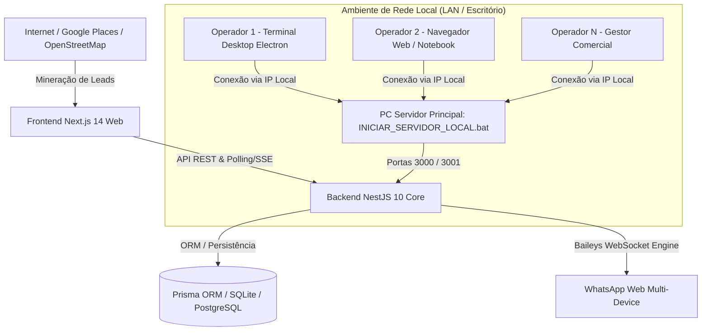

# 🚀 Radar de Oportunidades PRO — Plataforma SaaS All-in-One

<div align="center">


**O ecossistema definitivo para Prospecção Ativa B2B, CRM Visual Kanban, Chat Comercial Multiatendente com WhatsApp em Tempo Real, Robôs SDR de IA e Servidor Local em Rede (LAN).**

[-000000?style=flat-square&logo=next.js&logoColor=white)](https://nextjs.org/)
[](https://nestjs.com/)
[](https://www.electronjs.org/)
[](https://www.typescriptlang.org/)
[](https://tailwindcss.com/)
[](https://www.prisma.io/)
[](https://github.com/WhiskeySockets/Baileys)
[](https://radar-de-oportunidades-virid.vercel.app)
[](#)

[Demonstração Online](#-demonstração-online--acesso) •
[Funcionalidades](#-principais-módulos-do-sistema) •
[Arquitetura SaaS](#-arquitetura-do-sistema) •
[Chat Comercial](#-chat-comercial-de-vendas-whatsapp-multiatendente) •
[Instalação](#-como-executar-a-plataforma) •
[Modo Rede Local](#-arquitetura-servidor-local--rede-interna-lan)

---

</div>

## 🌐 Demonstração Online & Acesso

- 🔗 **Plataforma Web Cloud (Vercel)**: [https://radar-de-oportunidades-virid.vercel.app](https://radar-de-oportunidades-virid.vercel.app)
- 📊 **CRM Funil de Vendas**: `/pipeline`
- 💬 **Chat Comercial de Vendas (WhatsApp)**: `/chat-comercial`
- 🎯 **Radar de Leads & Prospecção**: `/leads`
- 🤖 **Fluxos & Modelos Conversacionais**: `/flows`
- 👥 **Usuários, Equipes & Metas**: `/users` & `/goals`

---

## 💡 Sobre o Radar de Oportunidades PRO

O **Radar de Oportunidades PRO** é uma solução **SaaS corporativa de alta performance** desenvolvida para estruturar e acelerar toda a operação comercial de empresas B2B.

A plataforma unifica desde a **mineração inteligente de novos clientes** em tempo real por nicho e geolocalização até a **qualificação automatizada de leads via WhatsApp**, transbordo ágil para operadores humanos através de uma **caixa de entrada comercial integrada com notificações visuais pulsantes** e gestão do ciclo de fechamento em um **funil Kanban completo**.

Adicionalmente, conta com uma **arquitetura de Servidor Local em Rede (LAN)** que permite que uma empresa mantenha um único WhatsApp conectado no computador principal enquanto todos os funcionários da equipe operam simultaneamente através de seus próprios computadores conectados pelo IP local ou pelo executável desktop Electron.

---

## 🏛️ Arquitetura do Sistema

O projeto é estruturado em formato **Monorepo corporativo escalável** utilizando **Turborepo** e **NPM Workspaces**:

```
radar-de-oportunidades/
├── apps/
│   ├── web/           # Frontend SaaS em Next.js 14 (App Router, Tailwind, Lucide, Zustand)
│   ├── api/           # Backend Core em NestJS 10 (Controllers, Services, Baileys, Prisma)
│   └── desktop/       # Cliente Desktop Electron (Auto-scanner de LAN, janela nativa)
├── packages/
│   └── types/         # Tipagens TypeScript compartilhadas entre Web, API e Desktop
├── prisma/            # Schema de banco de dados, migrações e client Prisma
├── INICIAR.bat                 # Inicializador 1-clique para Desenvolvimento Local
├── INICIAR_SERVIDOR_LOCAL.bat  # Inicializador para Servidor Local em Rede (0.0.0.0)
└── LIBERAR_REDE_LOCAL_ADMIN.bat # Script de liberação automática de Firewall do Windows
```



---

## 🚀 Principais Módulos do Sistema

### 1. 🎯 Prospecção Ativa & Inteligência Territorial (`/leads`)
- **Mineração por Nicho e Localidade**: busca em lote conectada com Google Places e OpenStreetMap para extrair razão social, telefones, endereço completo e dados cadastrais.
- **Higienização Automática de Telefones**: algoritmo inteligente que remove caracteres inválidos, ajusta DDI (+55), DDD e nono dígito, separando telefones fixos de celulares com WhatsApp.
- **Abordagem Direta Sem Ruído**: botão de contato personalizado com mensagem customizada no primeiro envio, direcionando o atendimento diretamente para o Chat Comercial de Vendas.
- **Gestão de Pastas & Lista Fria**: separação visual de contatos que não responderam para reaquecimento futuro com campanhas de nutrição.

### 2. 💬 Chat Comercial de Vendas Multiatendente (`/chat-comercial`)
- **Caixa de Entrada Integrada**: permite aos operadores conversarem com os clientes em tempo real direto pela plataforma, sem necessidade de abrir abas extras ou usar o WhatsApp Web pessoal.
- **Alerta Visual Pulsante com Cor Customizável**: quando uma nova mensagem de cliente chega, um badge visual pulsa intermitentemente ao lado de *"Atendimentos"*. A cor do alerta pode ser personalizada em tempo real pelo usuário (Laranja Comercial `#f97316`, Verde Esmeralda, Azul Ciano, Roxo Elétrico, Rosa Choque, Amarelo Ouro e Vermelho).
- **Início Imediato de Conversas**: modal de primeiro contato que injeta a conversa limpa no chat com histórico renovado.
- **Indicador de Status Online / Offline**: monitoramento em tempo real do estado da conexão do chip com opção de reconexão instantânea.

### 3. 📊 CRM Visual Funil de Vendas (`/pipeline`)
- **Quadro Kanban de 7 Estágios**:
  1. 📥 *Novo Lead*
  2. 🔍 *Lead Qualificado*
  3. 📞 *Contato Realizado*
  4. 📅 *Visita Agendada*
  5. 📑 *Proposta Enviada*
  6. 🤝 *Negociação*
  7. 🏆 *Contrato Fechado*
- **Arrastar e Soltar (Drag-and-Drop)**: movimentação suave e rápida de oportunidades entre os estágios comerciais.
- **Dashboard Financeiro Integrado**: cálculo automático de Total de Oportunidades, Valor da Carteira Ativa, Ticket Médio e Taxa de Conversão.
- **Histórico & Notas de CRM**: registro de anotações internas, valores propostos e produtos atrelados.

### 4. 🤖 Automação SDR & 15 Segmentos Comerciais Pré-Configurados (`/flows`)
- **15 Nichos de Mercado com Árvores de Conversação Completas**:
  1. 🩺 Clínica & Consultório Médico / Odontológico
  2. 🐾 Pet Shop & Clínica Veterinária
  3. 💻 Empresa de TI, Sites & Sistemas
  4. 🏢 Imobiliária & Corretores de Imóveis
  5. 🍕 Restaurante, Pizzaria & Delivery
  6. ⚖️ Escritório de Advocacia & Assessoria Jurídica
  7. 📊 Contabilidade, Fiscal & BPO
  8. 🚗 Oficina Mecânica & Auto Center
  9. 💅 Salão de Beleza, Estética & Barbearia
  10. 🛍️ Loja de Roupas, Calçados & Moda
  11. 🏋️‍♂️ Academia, Crossfit & Studio Fitness
  12. ☀️ Energia Solar & Engenharia Elétrica
  13. 🎓 Cursos, Idiomas & Treinamentos
  14. 🛡️ Segurança Eletrônica, CFTV & Alarmes
  15. 🧹 Limpeza, Dedetização & Serviços Prediais
- **Simulador de Smartphone Virtual**: teste a experiência do cliente em uma réplica interativa de celular dentro da tela antes de ativar os fluxos para o público.
- **Motor Anti-Banimento com Spintax**: gerador dinâmico de variações de mensagens (`{Olá|Oi|Como vai?}`) e intervalos randômicos simulando digitação humana.
- **Transbordo Imediato para Humano**: o robô pausa instantaneamente assim que um operador assume a conversa no Chat Comercial.

### 5. 👥 Equipes, Metas Comerciais & Gestão (`/team` & `/goals`)
- **Metas Individuais e Coletivas**: acompanhamento de faturamento mensal, número de propostas enviadas e conversões.
- **Catálogo de Produtos & Serviços (`/products`)**: cadastro de itens comerciais com precificação para montagem rápida de orçamentos.
- **Gestão de Usuários e Perfis (`/users`)**: personalização de foto de avatar (upload e preview com armazenamento Base64), nome, cargo e redefinição segura de credenciais.

---

## 🖥️ Arquitetura Servidor Local & Rede Interna (LAN)

O **Radar de Oportunidades PRO** foi especialmente otimizado para cenários corporativos onde o cliente prefere manter seu servidor local dentro do escritório:

```
[ MODEM / ROTEADOR WI-FI DO ESCRITÓRIO ]
                   │
    ┌──────────────┴──────────────┐
    ▼                             ▼
[ PC SERVIDOR ]           [ NOTEBOOKS / OPERADORES ]
IP: 192.168.1.100         Acessam via:
• WhatsApp Conectado      http://192.168.1.100:3000
• Banco de Dados Local    (Chat Comercial, Leads e CRM
• API Core (0.0.0.0:3001)  sincronizados em tempo real)
• Web Server (0.0.0.0:3000)
```

### Operação em 1 Clique com Arquivos `.bat`:

1. **`INICIAR_SERVIDOR_LOCAL.bat`**: 
   - Detecta o IP local da máquina servidora na placa de rede ativa.
   - Sobe a API NestJS e o Frontend Next.js ouvindo em `0.0.0.0` (todas as interfaces).
   - Apresenta na tela o endereço exato que os outros computadores do escritório devem digitar.
2. **`LIBERAR_REDE_LOCAL_ADMIN.bat`**: 
   - Executa via Administrador e cria as regras necessárias no Firewall do Windows para as portas `3000` e `3001`.
3. **Persistência de Conexão do WhatsApp**:
   - As credenciais de sessão do Baileys ficam guardadas na pasta de autenticação do servidor local. O WhatsApp nunca cai quando outros usuários entram na rede.

---

## 🛠️ Stack Tecnológica

| Camada | Tecnologia | Detalhes |
|---|---|---|
| **Frontend Web** | Next.js 14.2 (App Router) | React 18, Server Components, Client Actions, Hot Reload |
| **Estilização** | Tailwind CSS 3.4 | Glassmorphism, Dark UI, Lucide Icons, Animations |
| **Backend API** | NestJS 10.4 | TypeScript, RxJS, Modules, Guards, Interceptors |
| **Engine WhatsApp** | @whiskeysockets/baileys | Multi-Device WebSocket, QR Code dinâmico, Spintax |
| **Desktop App** | Electron 31+ | Empacotamento nativo Windows (.exe) com auto-discovery LAN |
| **Persistência** | Prisma ORM 5.22 | SQLite em ambiente local/LAN e PostgreSQL na Nuvem |
| **Gerenciamento de Estado** | Zustand | Notificações visuais em tempo real e preferências |
| **Notificações** | React Hot Toast | Feedback visual de operações e alertas |

---

## 💻 Como Executar a Plataforma

### Pré-requisitos
- **Node.js** v20.x ou superior instalado: [nodejs.org](https://nodejs.org/)
- **Git** instalado: [git-scm.com](https://git-scm.com/)

### 1. Clonar o Repositório
```bash
git clone https://github.com/WevcastDEV/radar.git
cd radar
```

### 2. Instalar as Dependências
```bash
npm install
```

### 3. Configurar Variáveis de Ambiente
Copie o arquivo de exemplo na raiz e em cada aplicativo:
```bash
cp .env.example .env
```

### 4. Inicialização Rápida no Windows

- **Para rodar em modo Servidor de Rede Local (LAN para todo o escritório)**:
  Basta dar um duplo clique em:
  ```cmd
  INICIAR_SERVIDOR_LOCAL.bat
  ```

- **Para rodar em modo Desenvolvimento Local**:
  ```cmd
  INICIAR.bat
  ```

- **Ou manualmente via terminal**:
  ```bash
  # Terminal 1 - Iniciar a API Core
  npm run dev --workspace=@radar/api

  # Terminal 2 - Iniciar a Interface Web
  npm run dev --workspace=@radar/web
  ```

Acesse em seu navegador:
- Local: **`http://localhost:3000`**
- Na rede do escritório: **`http://<IP-DO-SERVIDOR>:3000`**

---

## 📦 Compilação do Executável Desktop (Electron .exe)

Para gerar o instalador executável para Windows:

```bash
cd apps/desktop
npm install
npm run dist:win
```

O arquivo instalador `.exe` será gerado automaticamente no diretório `apps/desktop/dist/`.

---

## 🔒 Segurança & Boas Práticas

- **Credenciais Seguras**: Senhas armazenadas com hash criptográfico `bcrypt`.
- **Sessões Isoladas**: Chaves do WhatsApp salvas localmente e protegidas pelo `.gitignore`.
- **Prevenção Anti-Ban**: Spintax e cadência com tempos aleatórios para emular comportamento humano.
- **Validação de Inputs**: Higienização rigorosa contra injeções e vazamento de dados sensíveis.

---

## 👨‍💻 Autor & Direitos

Desenvolvido com excelência por **Weverton (WCTECH)**.  
- GitHub Oficial: [@WevcastDEV](https://github.com/WevcastDEV)  
- Repositório do Projeto: [https://github.com/WevcastDEV/radar](https://github.com/WevcastDEV/radar)  
- Demonstração Web: [Radar de Oportunidades PRO na Vercel](https://radar-de-oportunidades-virid.vercel.app)

---

<div align="center">
  <sub>Radar de Oportunidades PRO © Todos os direitos reservados.</sub>
</div>
